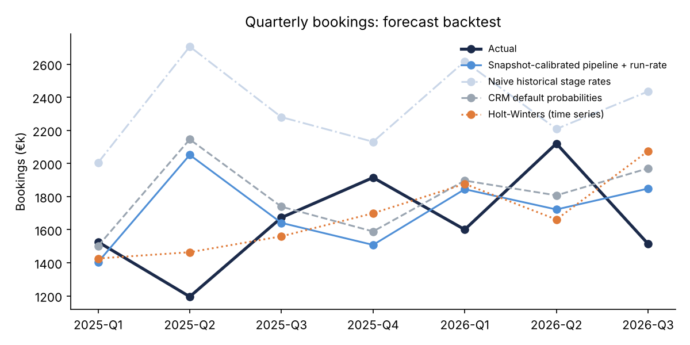

# Revenue Intelligence: Funnel, Bookings Forecast & Churn Risk

End-to-end revenue analytics across the customer journey, from **lead → MQL → SQL → opportunity → won → retained/expanded**. It contains a backtested bookings forecast with board scenarios, and a churn-risk model for Customer Success.

> All data is **synthetic** and generated with a fixed seed (`src/generate_data.py`): ~22k leads, ~2k opportunities, ~520 customer accounts, Jan 2023 – Sep 2026. It's realistic in shape (Q4 seasonality, channel and segment differences, stage drop-off, usage-driven churn) but it isn't real company data.

## Questions this answers

1. **What will we book next quarter, and how sure are we?** Pipeline model + run-rate, with P10/P50/P90 scenarios.
2. **Which forecast method should leadership trust?** A 7-quarter backtest of 5 methods, measured by MAPE.
3. **Which channels convert best, end to end?** A cohort funnel in SQL.
4. **Where is revenue leaking after the sale?** GRR/NRR plus a churn-risk model with a ranked at-risk list.

## Key results (see [`reports/report.md`](reports/report.md))

| Forecast method (backtest, 7 quarters) | MAPE |
|---|---|
| Holt-Winters time series (top-down) | **17.6%** |
| Ensemble (pipeline + Holt-Winters averaged) | 20.1% |
| Snapshot-calibrated pipeline + run-rate (bottom-up) | 22.7% |
| CRM default stage probabilities (10/25/50/75%) | 23.6% |
| Naive historical stage win rates | 47.7% |



**Finding 1: the "obvious" way to calibrate stage probabilities is badly biased.** Measuring *"what % of deals that ever reached Proposal were won"* gives 54%. But a deal that is *still* in Proposal at the start of the quarter it should close in usually belongs to the stalled group. Replaying past quarter starts gives the real number, 33%. The naive method overforecasts every quarter (MAPE 48%). The snapshot-calibrated method halves the error.

**Finding 2: no single method wins every quarter.** On this data the top-down time series has the lowest error, because the pipeline is small (~100 deals per quarter) and outcomes are noisy. In practice I'd show leadership both views, the bottom-up pipeline (explainable, actionable per deal) and the top-down trend (stable), and investigate when they disagree.

**Retention:** GRR 86.1%, NRR 91.8%. The churn model (logistic regression, 5-fold CV) reaches **AUC 0.70** with **2.5× lift** in the riskiest decile. Low product usage and support tickets are the strongest drivers, so the at-risk list goes to Customer Success with the reason attached.

## How the forecast works

```
forecast(Q) = Σ open deals due in Q  amount × P(win | stage at quarter start)   ← bottom-up pipeline
            + avg "create-and-close" bookings of the last 4 quarters             ← run-rate
```

- **No leakage:** win rates for a snapshot use only outcomes known before it. There's a unit test that deletes all future data and checks the rates don't change.
- **Scenarios:** Monte Carlo over deal outcomes (Bernoulli per deal) + ±20% run-rate noise → P10 / P50 / P90.
- **Time series:** Holt-Winters with additive trend + 12-month seasonality (trend-only fallback with < 2 years of history).

## Data model and CRM mapping

The pipeline is CRM-agnostic. The same columns exist in every major CRM:

| This project | Salesforce | HubSpot | Zoho CRM |
|---|---|---|---|
| `leads` (+ mql/sql dates) | Lead (Status, MQL/SQL date fields) | Contact (Lifecycle Stage) | Leads (Lead Status) |
| `opportunities` | Opportunity (StageName, Amount, CloseDate, IsWon) | Deal (dealstage, amount, closedate) | Deals (Stage, Amount, Closing Date) |
| `stage_history` | OpportunityHistory / Field History | Deal stage history properties | Stage History related list |
| `accounts` | Account + subscription object | Company + custom ARR property | Accounts + Subscriptions |

For production, I'd replace `generate_data.py` with an extract from the CRM API into a warehouse and keep `sql/` and `src/` unchanged.

## Run it

```bash
pip install -r requirements.txt
python -m src.generate_data     # writes data/*.csv
python -m src.report            # writes reports/report.md + charts
pytest -q                       # 6 tests incl. leakage + determinism
```

## Structure

```
src/generate_data.py   synthetic CRM data (seeded)
sql/funnel.sql         cohort funnel by channel (DuckDB SQL, portable)
src/forecast.py        stage calibration, pipeline + run-rate, Holt-Winters, backtest, Monte Carlo
src/retention.py       GRR/NRR, churn model (logistic regression, CV AUC, lift)
src/report.py          board-ready markdown report + charts
tests/                 determinism, no-leakage, ordering, model sanity
```

## Next steps

- Deal-level win model (deal age, stage velocity, activity count) instead of stage-only probabilities
- Push forecast + at-risk list back into the CRM (Opportunity forecast category, Account health field)
- Power BI / Tableau dashboard on top of the report tables
