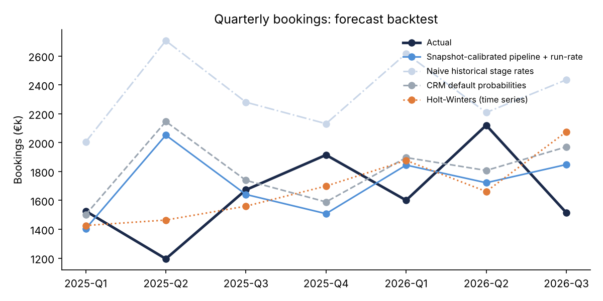
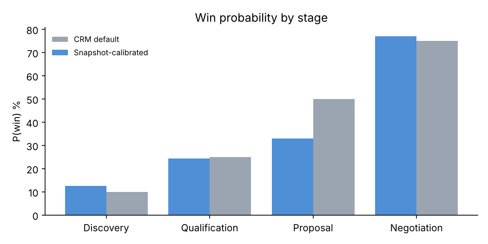

# Revenue Intelligence Report (synthetic data)

## 1. Next-quarter bookings outlook (Q4 2026)
- Open pipeline closing in Q4: **90 deals**, weighted value **€1,054k**
- Expected create-and-close run-rate: **€373k**
- Scenarios (Monte Carlo, 5,000 runs): downside P10 **€1,150k** · base P50 **€1,420k** · upside P90 **€1,703k**

## 2. Forecast accuracy (backtest, 7 quarters)
| Method | MAPE |
|---|---|
| Ensemble (pipeline + Holt-Winters, averaged) | **20.1%** |
| Snapshot-calibrated pipeline + run-rate | 22.7% |
| Naive historical stage win rates + run-rate | 47.7% |
| CRM default stage probabilities + run-rate | 23.6% |
| Holt-Winters time series | 17.6% |

| quarter   | actual   | ensemble   | calibrated_pipeline   | naive_history_pipeline   | crm_default_pipeline   | holt_winters   |
|:----------|:---------|:-----------|:----------------------|:-------------------------|:-----------------------|:---------------|
| 2025-Q1   | €1,526k  | €1,415k    | €1,404k               | €2,005k                  | €1,501k                | €1,426k        |
| 2025-Q2   | €1,195k  | €1,758k    | €2,052k               | €2,706k                  | €2,146k                | €1,464k        |
| 2025-Q3   | €1,673k  | €1,600k    | €1,641k               | €2,280k                  | €1,739k                | €1,560k        |
| 2025-Q4   | €1,915k  | €1,603k    | €1,508k               | €2,131k                  | €1,589k                | €1,699k        |
| 2026-Q1   | €1,601k  | €1,861k    | €1,844k               | €2,617k                  | €1,896k                | €1,877k        |
| 2026-Q2   | €2,120k  | €1,692k    | €1,722k               | €2,208k                  | €1,807k                | €1,661k        |
| 2026-Q3   | €1,514k  | €1,961k    | €1,848k               | €2,435k                  | €1,970k                | €2,075k        |

Calibrated vs default stage probabilities:

| Stage | CRM default | Calibrated |
|---|---|---|
| Discovery | 10% | 13% |
| Qualification | 25% | 24% |
| Proposal | 50% | 33% |
| Negotiation | 75% | 77% |

## 3. Funnel by channel (2025 lead cohorts)
| channel   |   leads |   mqls |   sqls |   opps |   won |   won_eur |   lead→won % |   win rate % |   € per lead |
|:----------|--------:|-------:|-------:|-------:|------:|----------:|-------------:|-------------:|-------------:|
| Events    |     940 |    280 |    116 |     72 |    17 |    735600 |         1.81 |         23.6 |          783 |
| Inbound   |    2921 |   1151 |    449 |    319 |    82 |   3129100 |         2.81 |         25.7 |         1071 |
| Outbound  |    1618 |    363 |    130 |     95 |    26 |   1138300 |         1.61 |         27.4 |          704 |
| Partner   |     983 |    465 |    178 |    130 |    41 |   1450200 |         4.17 |         31.5 |         1475 |

## 4. Retention
- GRR **86.1%** · NRR **91.8%** · logo churn 13.8%
- Churn-risk model (logistic regression, 5-fold CV): AUC **0.70**, top-decile lift **2.5×** (n=471)
- Drivers (standardised coefficients, + = more churn): usage_score -0.60, support_tickets_90d +0.40, nps -0.35, tenure_months +0.02, seats +0.08

Top 10 active accounts by churn risk (hand to Customer Success):

| account_id   | segment    |   arr_eur |   usage_score |   support_tickets_90d |   nps | churn_risk   |
|:-------------|:-----------|----------:|--------------:|----------------------:|------:|:-------------|
| A00557       | Mid-Market |     25500 |          30.5 |                     8 |     6 | 65%          |
| A00505       | SMB        |     10000 |          27.5 |                     6 |    13 | 53%          |
| A00072       | Mid-Market |     13200 |           6.3 |                     2 |    28 | 45%          |
| A00856       | Enterprise |    174300 |          47.1 |                     3 |   -37 | 44%          |
| A00482       | SMB        |      6200 |          54.5 |                     8 |     3 | 44%          |
| A00858       | Mid-Market |     41300 |          34.2 |                     2 |   -38 | 43%          |
| A00891       | Mid-Market |     56500 |          60   |                     6 |   -36 | 43%          |
| A00219       | Mid-Market |     30000 |          51.4 |                     7 |     5 | 42%          |
| A00206       | SMB        |      3400 |          24.3 |                     3 |    10 | 40%          |
| A00972       | Mid-Market |     34500 |          51.4 |                     5 |   -19 | 38%          |
